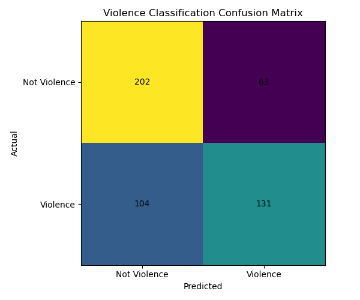

# Violence Detection Using BERT

A binary text-classification project that uses a fine-tuned BERT model to classify text as **VIOLENCE** or **NOT VIOLENCE**. The project includes dataset preparation, text preprocessing, model training, evaluation, and interactive prediction.

## Overview

Online platforms need ways to identify potentially violent language in text. This project fine-tunes the pretrained `bert-base-uncased` transformer model to classify text into two categories.

### Features

- Download the violence dataset using Hugging Face Datasets
- Convert the original three-class labels into a binary classification task
- Remove missing records and duplicate text entries during dataset preparation
- Clean URLs and normalize whitespace
- Tokenize text using the BERT tokenizer
- Fine-tune BERT for sequence classification
- Evaluate the model using precision, recall, F1-score, accuracy, and a confusion matrix
- Run interactive predictions from the command line
- Store the trained model weights using Git Large File Storage (Git LFS)

## Model Performance

The saved evaluation report in `results/violence/classification_report.txt` records the following performance on a test set of 500 examples.

| Metric | NOT VIOLENCE | VIOLENCE |
|---|---:|---:|
| Precision | 66.01% | 67.53% |
| Recall | 76.23% | 55.74% |
| F1-score | 70.75% | 61.07% |
| Test support | 265 | 235 |

### Overall metrics

| Metric | Result |
|---|---:|
| Accuracy | 66.60% |
| Macro precision | 66.77% |
| Macro recall | 65.99% |
| Macro F1-score | 65.91% |
| Weighted F1-score | 66.20% |

The model correctly classified 333 of the 500 test examples according to the saved report.

**Interpretation:** The model identifies non-violent text more reliably than violent text in this evaluation. Its violence-class recall is 55.74%, meaning it misses a substantial proportion of violent examples. These results indicate that the classifier needs further improvement before it should be considered for consequential moderation decisions.

### Confusion Matrix

The confusion matrix uses the following class order:

- `0`: NOT VIOLENCE
- `1`: VIOLENCE

| Actual / Predicted | NOT VIOLENCE | VIOLENCE |
|---|---:|---:|
| NOT VIOLENCE | 202 | 63 |
| VIOLENCE | 104 | 131 |



The matrix indicates that 104 of the 235 violent examples in the test set were classified as non-violent. This is an important limitation when interpreting the model's predictions.

## Technology Stack

- **Language:** Python
- **Deep learning:** PyTorch
- **Transformer model:** Hugging Face Transformers, BERT
- **Dataset handling:** Hugging Face Datasets
- **Data processing:** Pandas, NumPy
- **Evaluation:** Scikit-learn
- **Visualization:** Matplotlib
- **Version control:** Git and Git LFS

## Project Structure

```text
Violence-Detection/
├── dataset.py
├── download_dataset.py
├── preprocessing.py
├── train.py
├── evaluate.py
├── inference.py
├── requirements.txt
├── .gitignore
├── .gitattributes
├── models/
│   └── violence_bert/
│       ├── config.json
│       ├── model.safetensors
│       ├── tokenizer.json
│       ├── tokenizer_config.json
│       └── training_args.bin
└── results/
    └── violence/
        ├── classification_report.txt
        └── confusion_matrix.png
```

The `data/` directory is generated locally. It contains the downloaded source dataset and the prepared training, validation, and test CSV files. The generated `test_predictions.csv` is excluded from version control.

## Dataset

The project downloads the dataset identified as `kcrl/Violence` on Hugging Face.

Dataset page: https://huggingface.co/datasets/kcrl/Violence

Run the dataset download script to retrieve and prepare the source data:

```bash
python download_dataset.py
```

The script loads the available dataset splits, selects the `text` and `label` columns, concatenates the splits, removes missing values and duplicate text, and saves the resulting dataset to:

```text
data/violence/violence_data.csv
```

### Label Mapping

The download script converts the original three-class labels into a binary classification task.

| Original label | Final label | Meaning |
|---|---:|---|
| 0 — Non-Violence | 0 | NOT VIOLENCE |
| 1 — Passive Violence | 1 | VIOLENCE |
| 2 — Direct Violence | 1 | VIOLENCE |

This means both passive and direct violence are grouped into the same positive class.

### Dataset Preparation and Splitting

The `dataset.py` script:

1. Loads `data/violence/violence_data.csv`.
2. Checks for the required `text` and `label` columns.
3. Removes missing values and retains only labels 0 and 1.
4. Converts text to strings and labels to integers.
5. Shuffles the data using random state 42.
6. Limits the working dataset to a maximum of 5,000 samples.
7. Creates stratified training, validation, and test splits.

The intended split is:

| Split | Proportion | Approximate size when using 5,000 records |
|---|---:|---:|
| Training | 80% | 4,000 |
| Validation | 10% | 500 |
| Testing | 10% | 500 |

The actual split sizes depend on the number of usable records available.

The generated CSV files are saved to `data/violence/`:

- `train.csv`
- `validation.csv`
- `test.csv`

## Text Preprocessing

The `preprocessing.py` module defines text-cleaning and CSV-loading functions.

The `clean_text()` function:

- Converts the input to a string
- Removes URL patterns beginning with `http` or `www`
- Replaces repeated whitespace with a single space
- Removes leading and trailing whitespace

The BERT tokenizer truncates sequences and pads them to a maximum length of 64 tokens.

## Installation

### Prerequisites

- Python compatible with the pinned package versions
- Git
- Git LFS
- Internet access for downloading the dataset and pretrained model when needed

### 1. Clone the repository

```bash
git clone https://github.com/v78135236-dev/Violence-Detection.git
cd Violence-Detection
```

### 2. Create a virtual environment

On Windows PowerShell:

```powershell
python -m venv .venv
.\.venv\Scripts\Activate.ps1
```

### 3. Install dependencies

```bash
python -m pip install --upgrade pip
pip install -r requirements.txt
```

The repository pins the following dependency versions:

```text
torch==2.7.0
transformers==5.15.1
datasets==5.0.1
pandas==2.3.3
numpy==2.3.5
scikit-learn==1.7.2
matplotlib==3.10.6
accelerate==1.14.0
```

### 4. Retrieve the trained model

The final model weights are tracked using Git LFS. Install Git LFS and retrieve the model files:

```bash
git lfs install
git lfs pull
```

Ensure `models/violence_bert/model.safetensors` contains the actual model weights rather than an LFS pointer.

## Training

First, download and prepare the dataset:

```bash
python download_dataset.py
```

Then train the model:

```bash
python train.py
```

The training script loads the prepared dataset, creates the stratified splits, tokenizes the text, fine-tunes BERT, and saves the model and tokenizer.

### Training Configuration

| Parameter | Value |
|---|---|
| Base model | `bert-base-uncased` |
| Maximum dataset samples | 5,000 |
| Number of classes | 2 |
| Maximum sequence length | 64 tokens |
| Training batch size | 8 |
| Evaluation batch size | 8 |
| Epochs | 2 |
| Learning rate | `2e-5` |
| Weight decay | `0.01` |
| Best-model selection | Lowest evaluation loss |
| Checkpoint retention | 1 |

The model and tokenizer are saved to:

```text
models/violence_bert/
```

Training can take considerable time, especially when running on a CPU.

## Evaluation

Run evaluation after the dataset splits and trained model are available:

```bash
python evaluate.py
```

The evaluation script loads `data/violence/test.csv`, tokenizes the test examples, loads the saved model, generates predictions, and calculates classification metrics.

The script generates the following artifacts:

| File | Purpose |
|---|---|
| `results/violence/classification_report.txt` | Precision, recall, F1-score, support, and accuracy |
| `results/violence/confusion_matrix.png` | Visualization of actual versus predicted labels |
| `results/violence/test_predictions.csv` | Test records with predicted labels and class names |

The prediction CSV is excluded from Git through `.gitignore`.

**Reproducibility note:** The metrics documented above come from the saved report in this repository. Retraining the model or changing the dataset may produce different results. Regenerate the report before updating the performance figures.

## Interactive Inference

Run the interactive classifier:

```bash
python inference.py
```

Enter a text sample at the prompt. Type `exit` to stop.

Example session (illustrative output only):

```text
=======================================================
VIOLENCE CLASSIFIER
=======================================================

Enter text to classify.
Type 'exit' to stop.

Text: Example text to classify

Prediction: NOT VIOLENCE
Confidence: 0.XXXX

Class probabilities:
NOT VIOLENCE: 0.XXXX
VIOLENCE: 0.XXXX
```

The prediction and probabilities depend on the supplied text and the trained model. The example above does not represent a verified prediction.

### Use the Prediction Function in Python

```python
from inference import predict

text = "Example text to classify"

predicted_class, confidence, probabilities = predict(text)

label = "VIOLENCE" if predicted_class == 1 else "NOT VIOLENCE"

print("Prediction:", label)
print("Confidence:", round(confidence, 4))
print("Probabilities:", probabilities)
```

The `predict()` function returns:

- The predicted class ID (`0` or `1`)
- The predicted class confidence
- Softmax probabilities ordered as NOT VIOLENCE, then VIOLENCE

Confidence is a model-generated probability, not a guarantee that a classification is correct.

## Limitations and Responsible Use

- The saved evaluation accuracy is 66.60%; performance is not yet strong enough to support high-stakes decisions without further validation.
- Violence-class recall is 55.74%, so the model misses a meaningful proportion of violent examples.
- The training pipeline uses at most 5,000 records, which limits the amount of data used for fine-tuning.
- The dataset's labels and source distribution may not represent all forms of violent language, contexts, dialects, or languages.
- Context, quotation, satire, fictional dialogue, and discussion of violence can be difficult to classify from text alone.
- The model should not be treated as a definitive judge of a person's intent or as the sole basis for content removal or disciplinary action.

For practical moderation use, evaluate the model on representative, independently collected data and include appropriate human review and appeal processes.

## Future Improvements

- Increase and diversify the training dataset.
- Improve recall for the violence class.
- Compare against simpler baseline models.
- Tune decision thresholds using validation data.
- Evaluate performance across different text sources and language varieties.
- Add automated tests for preprocessing and inference.
- Build an API or interface for interactive demonstrations.
- Track model versions and evaluation metrics across experiments.

## Author and Repository

**GitHub repository:** https://github.com/v78135236-dev/Violence-Detection

## License

No license file was identified in the inspected project files. Add a `LICENSE` file before distributing the project under a specific open-source license.
